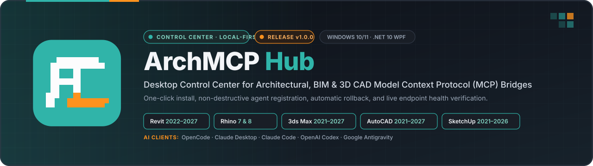
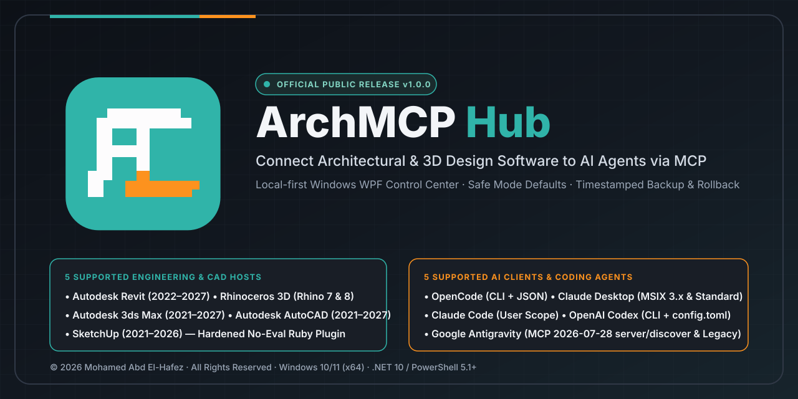

<div align="center">



# ArchMCP Hub

**Local-First Windows Desktop Control Center for Architectural, BIM & 3D CAD Model Context Protocol (MCP) Integrations**

[](RELEASE-NOTES-v1.0.0.md)
[-0078D6?style=flat-square&logo=windows)](docs/installation/INSTALLATION.md)
[](src/ArchMCP.Hub.App/ArchMCP.Hub.App.csproj)
[-5391FE?style=flat-square&logo=powershell)](scripts/)
[](docs/TEST-PLAN.md)
[-FD921E?style=flat-square)](LICENSE)

[**English Documentation**](README.md) · [**الدليل العربي (Arabic README)**](README-AR.md) · [**Installation**](docs/installation/INSTALLATION.md) · [**User Guide**](docs/usage/USER-GUIDE.md) · [**Compatibility**](docs/compatibility/COMPATIBILITY.md) · [**Architecture**](docs/architecture/ARCHITECTURE.md) · [**Troubleshooting**](docs/troubleshooting/TROUBLESHOOTING.md) · [**Changelog**](CHANGELOG.md)

</div>

---

## Table of Contents

1. [Overview & Purpose](#1-overview--purpose)
2. [Verified Features](#2-verified-features)
3. [Supported Engineering Applications](#3-supported-engineering-applications)
4. [Supported AI Clients (MCP Agents)](#4-supported-ai-clients-mcp-agents)
5. [Architecture & Integration Workflow](#5-architecture--integration-workflow)
6. [Application Interface & Visual Preview](#6-application-interface--visual-preview)
7. [System Requirements](#7-system-requirements)
8. [Installation Instructions](#8-installation-instructions)
9. [Step-by-Step Usage Instructions](#9-step-by-step-usage-instructions)
10. [Integration Verification Procedures](#10-integration-verification-procedures)
11. [Compatibility Matrix (Implemented vs. Verified)](#11-compatibility-matrix-implemented-vs-verified)
12. [Troubleshooting](#12-troubleshooting)
13. [Repository Structure](#13-repository-structure)
14. [Build-from-Source Instructions](#14-build-from-source-instructions)
15. [Security, Permissions & Privacy](#15-security-permissions--privacy)
16. [Release Information & Changelog](#16-release-information--changelog)
17. [Ownership & Licensing](#17-ownership--licensing)
18. [Contribution & Support Information](#18-contribution--support-information)

---

## 1. Overview & Purpose

**ArchMCP Hub (`v1.0.0`)** is a native Windows desktop control center built with **C# / .NET 10 WPF** and **Windows PowerShell 5.1+** that automates the discovery, installation, configuration, repair, uninstallation, and live health verification of **Model Context Protocol (MCP)** bridges across architectural, BIM, and 3D modeling software.

Connecting engineering software (**Autodesk Revit**, **Rhinoceros 3D**, **Autodesk 3ds Max**, **Autodesk AutoCAD**, and **SketchUp**) to modern AI coding and design agents (**OpenCode**, **Claude Desktop**, **Claude Code**, **OpenAI Codex**, and **Google Antigravity**) manually is error-prone: users face Python virtual environment locks, incompatible upstream dependency pins, MSIX package-shadowed configuration files, UTF-8 BOM parsing failures, and protocol mismatches (`2024-11-05` `initialize` vs. `2026-07-28` `server/discover`).

ArchMCP Hub solves these problems through a **local-first, non-destructive control plane**:
- It scans your workstation for real installed CAD executables (filtering out stale registry entries and third-party add-ins).
- It bootstraps an isolated, user-local Python toolchain (`uv` / `uvx`) without requiring Windows Administrator privileges.
- It deploys and configures each host bridge with automatic timestamped backups (`.backup-YYYYMMDD-HHMMSS`) and automatic rollback on failure.
- It validates the MCP `stdio` handshake before committing AI client configuration updates and distinguishes static file installation (`Installed (Awaiting Host)`) from live in-host verification (`Verified (Live)`).

---

## 2. Verified Features

- **Real Host Executable Discovery (`EnvironmentScanner.cs`)**:
  Scans `Program Files`, `Program Files (x86)`, and 32-bit/64-bit Windows Uninstall Registry keys, retaining only verified host binaries (`Revit.exe`, `Rhino.exe`, `3dsmax.exe`, `acad.exe`, `SketchUp.exe`).
- **Complete 4-Action Lifecycle (`Install & connect`, `Disable / Uninstall`, `Repair`, `Verify`)**:
  Manage every integration directly from the desktop UI with automatic status refresh when the PowerShell operation window closes.
- **Bilingual UI & Dual Theme Support**:
  Instant runtime switching between **English** and **Arabic** (`EN / عربي`) and between **Dark Mode** and **Light Mode**.
- **Legacy & Modern CAD Version Coverage**:
  - Automatic 32-bit/64-bit `ElementId` compatibility patching (`Apply-Revit2022CompatibilityPatch`) enabling **Revit 2022–2023** alongside **Revit 2024–2027**.
  - Dedicated **Rhino 7** pinned Python 3.12 socket bridge (`reer-ide/rhino_mcp`) alongside **Rhino 8** McNeel Yak package deployment (`jingcheng-chen/rhinomcp`).
  - Per-user startup MAXScript listener (`mcp_server.ms` on TCP `:8765`) for **3ds Max 2021–2027** plus native C++ Global Utility Plugin (`.gup`) bundle deployment for **3ds Max 2023–2027**.
  - Normalized **SketchUp 2021–2026** Ruby extension deployment (`Resolve-SketchUpRubyPluginSource` ensuring `Plugins\su_mcp.rb` and `Plugins\su_mcp\main.rb`) and direct `.venv` Python 3.12 launcher (`archmcp_sketchup_server.py`).
- **Non-Destructive Multi-Agent Registration**:
  Preserves all unrelated MCP servers and user settings in `opencode.json`, `claude_desktop_config.json`, `.claude.json`, `config.toml`, and `mcp_config.json`, writing strict **UTF-8 without BOM**.
- **Claude Desktop 3.x (MSIX) & Google Antigravity (`2026-07-28`) Compatibility**:
  - Automatically targets `%LOCALAPPDATA%\Claude-Data\claude_*\claude_desktop_config.json` on Claude Desktop 3.x MSIX installs (seeding from existing `%APPDATA%` configs) and registers direct `.venv` Python launchers.
  - Provisions a separate `.venv-modern` (`mcp>=2,<3`) with `scripts/shims/archmcp_mcp2_entry.py` for compatible FastMCP v1 servers when registering with **Google Antigravity**, passing both `2026-07-28` (`server/discover`) and legacy `initialize` handshakes.
- **Windows PowerShell 5.1 Hardening**:
  All 8 `.ps1` scripts are 100% 7-bit ASCII clean (preventing Windows-1252 parser errors), wrap native tools in `Invoke-ArchMcpNativeCommand` (preventing `stderr` `NativeCommandError` aborts), use lock-safe `robocopy` excluding `.venv`, and keep terminal windows open via `Wait-ArchMcpWindowClose`.

---

## 3. Supported Engineering Applications

| Host Application | Supported Versions | Unsupported Versions | Upstream MCP Repository | Upstream License | Local Transport & In-Host Bridge |
| :--- | :--- | :--- | :--- | :--- | :--- |
| **Autodesk Revit** | **2022 – 2027** | 2021 and older | [`Demolinator/revit-mcp-server`](https://github.com/Demolinator/revit-mcp-server) | MIT | `stdio` → FastMCP → HTTP `:48884` → `pyRevit` Routes (`revit-mcp.extension`) |
| **Rhinoceros 3D** | **Rhino 7 & Rhino 8** | Rhino 6 and older | [`jingcheng-chen/rhinomcp`](https://github.com/jingcheng-chen/rhinomcp) (v8)<br>[`reer-ide/rhino_mcp`](https://github.com/reer-ide/rhino_mcp) (v7) | MIT | `stdio` → Python MCP → TCP `:1999` (Rhino 8 Yak) / `:9877` (`rhino_mcp_bridge.py` in Rhino 7) |
| **Autodesk 3ds Max** | **2021 – 2027** | 2020 and older | [`cl0nazepamm/3dsmax-mcp`](https://github.com/cl0nazepamm/3dsmax-mcp) | MIT | `stdio` → FastMCP → Named Pipe (2023+ `.gup`) / MAXScript TCP `:8765` (2021–2027) |
| **Autodesk AutoCAD** | **2021 – 2027** | 2020 and older | [`U-C4N/Autocad-MCP`](https://github.com/U-C4N/Autocad-MCP) | MIT | `stdio` → FastMCP → Live AutoCAD ActiveX/COM (`AutoCAD.Application`) + Headless `ezdxf` |
| **SketchUp** | **2021 – 2026** | 2020 and older | [`NeoNexAI/sketchup-mcp`](https://github.com/NeoNexAI/sketchup-mcp) *(hardened fork of [`mhyrr/sketchup-mcp`](https://github.com/mhyrr/sketchup-mcp))* | MIT | `stdio` → FastMCP → TCP `127.0.0.1:9876` → SketchUp Ruby Plugin (`su_mcp.rb` + `su_mcp/main.rb`) |

---

## 4. Supported AI Clients (MCP Agents)

| AI Client | Configuration File Target(s) | Environment Variable Override | Registration Mechanism |
| :--- | :--- | :--- | :--- |
| **OpenCode** | `~/.config/opencode/opencode.json` | `OPENCODE_CONFIG`, `XDG_CONFIG_HOME` | `opencode mcp add <name> --global` CLI + non-destructive JSON merge |
| **Claude Desktop** | `%LOCALAPPDATA%\Claude-Data\claude_*\claude_desktop_config.json` (3.x MSIX)<br>`%LOCALAPPDATA%\Packages\Claude_*\LocalCache\Roaming\Claude\claude_desktop_config.json`<br>`%APPDATA%\Claude\claude_desktop_config.json` | — | Direct `.venv` Python launcher + UTF-8 no-BOM JSON merge + pre-commit `stdio` handshake + auto-rollback |
| **Claude Code** | `~/.claude.json` | `CLAUDE_CONFIG_DIR` | `claude mcp add --scope user <name>` CLI + non-destructive JSON merge |
| **OpenAI Codex** | `~/.codex/config.toml` | `CODEX_HOME` | `codex mcp add <name>` CLI + `[mcp_servers.<name>]` TOML section merge |
| **Google Antigravity** | `~/.gemini/config/mcp_config.json` (and `~/.gemini/antigravity/mcp_config.json` if present) | — | Direct `.venv` / `.venv-modern` (`archmcp_mcp2_entry.py`) launcher + dual-era MCP handshake (`2026-07-28` `server/discover` & legacy `initialize`) |

---

## 5. Architecture & Integration Workflow

### System Architecture (Control Plane vs. Runtime Data Plane)


### 5-Stage Safe Installation & Verification Lifecycle


For deep architectural details and Architecture Decision Records (`ADR-001` through `ADR-008`), see [`docs/architecture/ARCHITECTURE.md`](docs/architecture/ARCHITECTURE.md) and [`docs/DECISIONS.md`](docs/DECISIONS.md).

---

## 6. Application Interface & Visual Preview



> **Honest Screenshot Notice:** Because this release package was prepared in a headless verification environment without live Windows CAD installations, no fabricated or synthetic application window screenshots are included. The actual WPF desktop interface is defined in [`src/ArchMCP.Hub.App/MainWindow.xaml`](src/ArchMCP.Hub.App/MainWindow.xaml) and [`src/ArchMCP.Hub.App/App.xaml`](src/ArchMCP.Hub.App/App.xaml), featuring the official `ArchMCP.ico` / `ArchMCP.png` icon, status cards (**Design Applications**, **MCP Connections**, **Security Status**), the interactive host table, AI Agent selector, and action bar (**Install & connect**, **Disable / Uninstall**, **Repair**, **Verify**).

---

## 7. System Requirements

- **Operating System**: Windows 10 or Windows 11 (64-bit / `win-x64`).
- **PowerShell**: Windows PowerShell 5.1 (built into Windows) or PowerShell 7+.
- **.NET SDK / Runtime**: `.NET 10.0` (`net10.0-windows` / `net10.0`). If not installed globally, `Run-ArchMCP-Hub.bat` (`scripts/Setup-And-Run.ps1`) automatically installs a local copy into `.tools\dotnet\`.
- **Python & `uv`**: Automatically bootstrapped as a user-local binary to `%LOCALAPPDATA%\ArchMCP Hub\Tools\uv\uv.exe` from Astral's official GitHub release. Isolated Python environments (including pinned Python 3.12 where required) are provisioned automatically per integration.
- **Permissions**: Standard user account (`requiresElevation: false`). No Administrator rights required.
- **Host Prerequisites**:
  - **Autodesk Revit (2022–2027)** requires **[pyRevit](https://github.com/pyrevitlabs/pyRevit/releases/latest)** (`v4.8.16+` or `v5.x`).
  - **Rhino 7/8**, **3ds Max 2021–2027**, **AutoCAD 2021–2027**, and **SketchUp 2021–2026** require no external third-party add-in prerequisites prior to running ArchMCP Hub.

---

## 8. Installation Instructions

### Quick Start (Recommended)

1. Download and extract the `ArchMCP-Hub-v1.0.0` repository folder to any local directory on your Windows workstation.
2. Double-click **`Run-ArchMCP-Hub.bat`** at the root of the repository:
   ```bat
   Run-ArchMCP-Hub.bat
   ```
3. `Run-ArchMCP-Hub.bat` executes `scripts\Setup-And-Run.ps1`, which:
   - Verifies or bootstraps the `.NET SDK`,
   - Restores and builds `ArchMCP.Hub.sln` in `Release` mode,
   - Runs the automated unit tests (`dotnet test`),
   - Publishes the self-contained portable package to `dist\win-x64\ArchMCP.Hub.exe`, and
   - Launches **ArchMCP Hub v1.0.0**.

For detailed setup instructions and local directory paths, see [`docs/installation/INSTALLATION.md`](docs/installation/INSTALLATION.md).

---

## 9. Step-by-Step Usage Instructions

1. **Scan Installed Hosts**:
   Launch ArchMCP Hub (or click **Check environment** / `فحص البيئة` in the top-right bar) to discover all installed versions of Revit, Rhino, 3ds Max, AutoCAD, and SketchUp.
2. **Open the Integrations Tab**:
   Click **Integrations** (`التكاملات`) in the left navigation bar.
3. **Select Host & AI Agent**:
   - Click a detected engineering application row in the table.
   - Choose your target AI client (**OpenCode**, **Claude Desktop**, **Claude Code**, **OpenAI Codex**, or **Google Antigravity**) from the **AI AGENT** dropdown.
4. **Run an Action**:
   - **Install & connect** (`تثبيت وربط`): Downloads the upstream MCP server, synchronizes its isolated Python environment, deploys the host plugin/bridge, verifies the MCP handshake, and updates your AI client configuration.
   - **Disable / Uninstall** (`تعطيل / إلغاء تثبيت`): Removes the MCP server entry from all AI client configs, stops running integration processes, and removes the deployed host bridge and local server directory.
   - **Repair** (`إصلاح`): Re-synchronizes dependencies, re-applies compatibility patches, and repairs host/agent configuration files.
   - **Verify** (`فحص`): Checks both on-disk files and the live in-host health endpoint.

See the complete [**User Guide (`docs/usage/USER-GUIDE.md`)**](docs/usage/USER-GUIDE.md) for detailed instructions.

---

## 10. Integration Verification Procedures

ArchMCP Hub will only display **`Verified (Live)`** when the target engineering host is open and its internal listener responds:

| Engineering Host | How to Activate the Live In-Host Listener | Verification Endpoint Probed by ArchMCP Hub |
| :--- | :--- | :--- |
| **Autodesk Revit (2022–2027)** | Open Revit with a `.rvt` project document. If Revit was already open during install, click **pyRevit → Reload**. | HTTP `GET http://127.0.0.1:48884/revit_mcp/status/` (`status == "active"`) |
| **Rhinoceros 8** | Open Rhino 8 and run command: `mcpstart` | TCP `127.0.0.1:1999` |
| **Rhinoceros 7** | Open Rhino 7 → **Tools → PythonScript → Run...** → select `%APPDATA%\McNeel\Rhinoceros\7.0\scripts\rhino_mcp_bridge.py` | TCP `127.0.0.1:9877` / `127.0.0.1:1999` |
| **Autodesk 3ds Max (2021–2027)** | Start (or restart) 3ds Max so `mcp_server.ms` / `mcp_bridge.gup` loads on startup. | Named Pipe (`\\.\pipe\*3dsmax*`) or TCP `127.0.0.1:8765` |
| **Autodesk AutoCAD (2021–2027)** | Open AutoCAD with an unlocked drawing for live COM (Headless DXF works immediately without AutoCAD open). | Active `acad` process + COM `Marshal.GetActiveObject("AutoCAD.Application")` |
| **SketchUp (2021–2026)** | Open SketchUp → **Extensions → SketchUp MCP → Start Server** | TCP `127.0.0.1:9876` |

---

## 11. Compatibility Matrix (Implemented vs. Verified)

ArchMCP Hub strictly separates **implemented version support** from **verified end-to-end compatibility**. See [`docs/compatibility/COMPATIBILITY.md`](docs/compatibility/COMPATIBILITY.md), [`docs/COMPATIBILITY-MATRIX.csv`](docs/COMPATIBILITY-MATRIX.csv), and [`docs/AI-CLIENT-MATRIX.csv`](docs/AI-CLIENT-MATRIX.csv) for full details:

| Host + AI Client Combination | Config & Contract Tests | `stdio` Handshake (`initialize` / `tools/list`) | Client UI Tool Visibility | Live CAD Host Operation | Current Verification Status |
| :--- | :--- | :--- | :--- | :--- | :--- |
| **Revit (2022–2027) + OpenCode** | Passed | Passed (`48 tools`) | Owner-Confirmed | Owner-Confirmed | **Verified** |
| **AutoCAD (2021–2027) + OpenCode** | Passed | Passed (`217 tools`) | Owner-Confirmed | Owner-Confirmed | **Verified** |
| **Revit (2022–2027) + Claude Desktop** | Passed (`test_claude_desktop.ps1`) | Passed (`48 tools`) | Owner-Confirmed (3.x MSIX `Claude-Data`) | Requires Revit open on user machine | **Partially Verified** (Layers 1–3 confirmed) |
| **AutoCAD (2021–2027) + Claude Desktop** | Passed (`test_claude_desktop.ps1`) | Passed (`217 tools`) | Owner-Confirmed (3.x MSIX `Claude-Data`) | Requires AutoCAD open for COM | **Partially Verified** (Layers 1–3 confirmed) |
| **Revit (2022–2027) + Google Antigravity** | Passed (`test_claude_desktop.ps1` T7–T9) | Passed (`48 tools` on `2026-07-28` `server/discover` & `initialize`) | Pending live Antigravity UI check | Requires Revit open | **Partially Verified** (Server & protocol layers verified) |
| **Rhino 7 + OpenCode / Claude Desktop / Antigravity** | Passed (`test_rhino_env.ps1`) | Passed (`7 tools` on Python 3.12 `.venv` & `.venv-modern`) | Pending live client check | Requires Rhino 7 + `rhino_mcp_bridge.py` | **Partially Verified** (Server & protocol layers verified) |
| **SketchUp (2021–2026) + All 5 AI Clients** | Passed (`run_all_tests.py`) | Enforced by installer before config write | Pending live client check | Requires SketchUp + `Start Server` | **Implemented & Pre-Registration Handshake Gated** |
| **Rhino 8 & 3ds Max (2021–2027) + All 5 AI Clients** | Passed (`run_all_tests.py`) | Shared registration engine | Pending live client check | Requires Rhino 8 / 3ds Max open | **Implemented (Awaiting Live Workstation Run)** |
| **AutoCAD (2021–2027) + Google Antigravity** | Registered with warning | **Fails `2026-07-28` `server/discover`** (`fastmcp 3.x`) | **Not Working** in Antigravity `2026-07-28` | Blocked by upstream `fastmcp` | **Known Upstream Limitation** (Use OpenCode or Claude Desktop) |

---

## 12. Troubleshooting

- **Status stays `Installed (Awaiting Host)` after installation**:
  Open the CAD application and start its in-host bridge (see [Section 10](#10-integration-verification-procedures)), then click **Verify**.
- **Claude Desktop does not show newly installed tools**:
  Right-click the Claude Desktop icon in the Windows system tray (bottom-right taskbar) and click **Quit**, then relaunch Claude Desktop. Closing the window without quitting from the tray does not reload `claude_desktop_config.json`.
- **SketchUp shows `Error Loading File su_mcp/main`**:
  Click **Repair** in ArchMCP Hub v1.0.0. `Resolve-SketchUpRubyPluginSource` removes any nested `Plugins\su_mcp\su_mcp` or `.backup-*` items and deploys `su_mcp.rb` and `su_mcp\main.rb` cleanly.
- **Inspecting Diagnostic Logs**:
  Click **Activity & Logs → Open diagnostic log folder** in the UI to open `%LOCALAPPDATA%\ArchMCP Hub\Logs\`.

For complete solutions, see [`docs/troubleshooting/TROUBLESHOOTING.md`](docs/troubleshooting/TROUBLESHOOTING.md).

---

## 13. Repository Structure

```text
ArchMCP-Hub/
├── .github/
│   ├── ISSUE_TEMPLATE/
│   │   ├── bug_report.yml                    # Structured bug report template with secret warnings
│   │   ├── config.yml                        # Issue template routing links
│   │   └── feature_request.yml               # Compatibility evidence & feature template
│   ├── workflows/
│   │   └── ci-windows.yml                    # Windows CI workflow (build, xUnit, PS 5.1 AST, publish)
│   └── PULL_REQUEST_TEMPLATE.md              # PR stability & ASCII compliance checklist
├── assets/
│   ├── branding/
│   │   ├── architecture-diagram.svg          # Control plane vs. runtime data plane diagram
│   │   ├── github-banner.svg                 # Official horizontal GitHub header banner
│   │   ├── integration-workflow.svg          # 5-stage safe installation & verification workflow
│   │   ├── social-preview.png                # High-resolution OpenGraph social preview PNG
│   │   └── social-preview.svg                # Vector OpenGraph social preview SVG
│   ├── icons/
│   │   ├── ArchMCP.ico                       # Multi-resolution Windows ICO (16, 24, 32, 48, 64, 128, 256 px)
│   │   ├── ArchMCP.png                       # Official high-resolution application icon PNG
│   │   ├── ArchMCP-Origin-1254.png           # Preserved original 1254x1254 RGBA source icon
│   │   ├── ArchMCP-vector.svg                # Pixel-accurate vector representation of the official icon
│   │   └── ArchMCP-<size>x<size>.png         # Standard icon resolutions (16x16 through 512x512)
│   └── screenshots/
│       └── README.md                         # Guidelines for capturing real Windows UI screenshots
├── docs/
│   ├── architecture/
│   │   └── ARCHITECTURE.md                   # Detailed architecture & module reference
│   ├── compatibility/
│   │   ├── AI-CLIENT-MATRIX.csv              # Host x AI Client verification matrix
│   │   ├── COMPATIBILITY-MATRIX.csv          # Host version & bridge matrix
│   │   └── COMPATIBILITY.md                  # Compatibility policy & verification tiers
│   ├── development-notes/
│   │   └── README.md                         # Archived pre-release internal debugging notes
│   ├── installation/
│   │   └── INSTALLATION.md                   # Complete installation & prerequisite guide
│   ├── troubleshooting/
│   │   └── TROUBLESHOOTING.md                # Host & AI client troubleshooting guide
│   ├── usage/
│   │   └── USER-GUIDE.md                     # Step-by-step UI & CLI user guide
│   ├── AI-CLIENT-MATRIX.csv                  # Root docs copy preserved for tool compatibility
│   ├── ARCHITECTURE.md                       # Root docs copy preserved for tool compatibility
│   ├── COMPATIBILITY-MATRIX.csv              # Root docs copy preserved for tool compatibility
│   ├── DECISIONS.md                          # Architecture Decision Records (ADR-001 to ADR-008)
│   ├── TEST-PLAN.md                          # Automated test results & acceptance gates
│   └── TROUBLESHOOTING.md                    # Root docs copy preserved for tool compatibility
├── registry/
│   ├── integration-registry.schema.json      # JSON Schema (Draft 2020-12) for integration manifests
│   ├── integrations.example.json             # Example integration record
│   └── integrations.json                     # Production manifest for all 5 CAD hosts (v1.0.0)
├── scripts/
│   ├── shims/
│   │   └── archmcp_mcp2_entry.py             # MCP Python SDK 2.x compatibility shim for Antigravity
│   ├── ArchMCP-Common.ps1                    # Shared PowerShell 5.1+ installer/config/handshake library
│   ├── Install-3dsMax-MCP.ps1                # Autodesk 3ds Max 2021-2027 installer, verifier & uninstaller
│   ├── Install-AutoCAD-MCP.ps1               # Autodesk AutoCAD 2021-2027 installer, verifier & uninstaller
│   ├── Install-Integration.ps1               # Unified host action dispatcher
│   ├── Install-Revit-OpenCode.ps1            # Autodesk Revit 2022-2027 installer, verifier & uninstaller
│   ├── Install-Rhino-MCP.ps1                 # Rhinoceros 7 & 8 installer, verifier & uninstaller
│   ├── Install-SketchUp-MCP.ps1              # SketchUp 2021-2026 installer, verifier & uninstaller
│   └── Setup-And-Run.ps1                     # Local .NET SDK bootstrapper, builder, tester & publisher
├── src/
│   ├── ArchMCP.Hub.App/                      # WPF Desktop Application (.NET 10.0 Windows)
│   │   ├── Assets/
│   │   │   ├── ArchMCP.ico                   # Embedded application & window icon
│   │   │   └── ArchMCP.png                   # Sidebar header brand icon
│   │   ├── App.xaml                          # Application theme resources & styles
│   │   ├── App.xaml.cs                       # Startup lifecycle & diagnostic logging
│   │   ├── ArchMCP.Hub.App.csproj            # Project metadata (v1.0.0) & linked content rules
│   │   ├── MainWindow.xaml                   # Main Control Center UI layout
│   │   └── MainWindow.xaml.cs                # UI logic, bilingual strings & PowerShell process launcher
│   └── ArchMCP.Hub.Core/                     # Core Discovery & Compatibility Library (.NET 10.0)
│       ├── ArchMCP.Hub.Core.csproj           # Core library project file (v1.0.0)
│       ├── Compatibility.cs                  # Supported catalog & version range resolver
│       └── EnvironmentScanner.cs             # Read-only CAD executable scanner & live endpoint prober
├── tests/
│   ├── ArchMCP.Hub.Core.Tests/               # xUnit Test Project (.NET 10.0)
│   │   ├── ArchMCP.Hub.Core.Tests.csproj     # xUnit test project configuration
│   │   └── CompatibilityResolverTests.cs     # 17 unit tests for version bounds & release selection
│   ├── run_all_tests.py                      # 14 Python contract, ASCII, ZIP & schema tests
│   ├── test_claude_desktop.ps1               # Claude Desktop & multi-agent registration test harness
│   └── test_rhino_env.ps1                    # Rhino 7 Python 3.12 & MCP 2.x environment test harness
├── .editorconfig                             # Formatting & PowerShell 7-bit ASCII rules
├── .gitattributes                            # CRLF/LF normalization & binary protection
├── .gitignore                                # Build, toolchain, log & secret exclusions
├── ArchMCP.Hub.sln                           # Visual Studio 2022+ Solution File
├── CHANGELOG.md                              # Official release changelog starting at [1.0.0]
├── CODE_OF_CONDUCT.md                        # Community standards
├── CONTRIBUTING.md                           # Contribution & technical rules
├── LICENSE                                   # Custom Proprietary License (All Rights Reserved)
├── README-AR.md                              # Complete Arabic documentation (الدليل العربي الشامل)
├── README.md                                 # Primary English documentation
├── RELEASE-NOTES-v1.0.0.md                   # v1.0.0 public release notes
├── Run-ArchMCP-Hub.bat                       # One-click Windows build & launch entry point
├── SECURITY.md                               # Security architecture & reporting policy
├── SUPPORT.md                                # Self-service diagnostics & support guide
└── THIRD-PARTY-NOTICES.md                    # Upstream MCP attributions, licenses & trademarks
```

---

## 14. Build-from-Source Instructions

To build, test, and publish **ArchMCP Hub v1.0.0** manually using the .NET 10.0 SDK on Windows:

```powershell
# 1. Restore NuGet packages
dotnet restore .\ArchMCP.Hub.sln

# 2. Build the solution in Release configuration
dotnet build .\ArchMCP.Hub.sln -c Release --no-restore

# 3. Run the xUnit automated test suite
dotnet test .\ArchMCP.Hub.sln -c Release --no-build

# 4. Run the Python contract, PowerShell 5.1 ASCII & JSON schema test suite
python .\tests\run_all_tests.py

# 5. Publish a self-contained single-file Windows x64 executable
dotnet publish .\src\ArchMCP.Hub.App\ArchMCP.Hub.App.csproj `
  -c Release `
  -r win-x64 `
  --self-contained true `
  -p:PublishSingleFile=true `
  -p:IncludeNativeLibrariesForSelfExtract=true `
  -o .\dist\win-x64
```

The published package will be generated at `.\dist\win-x64\ArchMCP.Hub.exe` alongside the required `scripts\` and `registry\` folders.

---

## 15. Security, Permissions & Privacy

- **100% Local Execution**: ArchMCP Hub does not require a cloud account and never collects or transmits telemetry, project files, or personal data.
- **No Administrator Elevation Required**: All toolchains (`%LOCALAPPDATA%\ArchMCP Hub\Tools\uv\`), server repositories (`%LOCALAPPDATA%\ArchMCP Hub\Integrations\`), and CAD host plugins install into user-level directories (`requiresElevation: false`).
- **Loopback-Only Bridges (`127.0.0.1`)**: All local HTTP/TCP/Named Pipe endpoints bind exclusively to `127.0.0.1`.
- **Safe Mode & Scoped Paths**:
  - **3ds Max**: Enables `safe_mode = true` in `%LOCALAPPDATA%\3dsmax-mcp\mcp_config.ini`.
  - **AutoCAD**: Scopes `ALLOWED_PATHS` to `%USERPROFILE%\Documents\AutoCAD` and sets `DANGEROUS_COMMANDS_ENABLED = false`.
  - **SketchUp**: Uses the hardened `NeoNexAI/sketchup-mcp` implementation with `eval_ruby` removed.
- **Automatic Backups & Rollback**: Every modified configuration file and plugin directory is backed up to `.backup-YYYYMMDD-HHMMSS` before changes are written and automatically restored if any step fails.

See [`SECURITY.md`](SECURITY.md) for full details.

---

## 16. Release Information & Changelog

- **Current Official Release**: **`v1.0.0`** (Initial Public Release)
- **Release Notes**: [`RELEASE-NOTES-v1.0.0.md`](RELEASE-NOTES-v1.0.0.md)
- **Full Changelog**: [`CHANGELOG.md`](CHANGELOG.md)
- **Pre-Release Engineering Notes**: [`docs/development-notes/README.md`](docs/development-notes/README.md)

---

## 17. Ownership & Licensing

- **Project Owner & Author**: **Mohamed Abd El-Hafez**
- **Copyright**: **Copyright © 2026 Mohamed Abd El-Hafez. All Rights Reserved.**
- **License**: Custom Proprietary License — see [`LICENSE`](LICENSE).
  - Public availability of this repository does **not** grant permission to copy, modify, redistribute, or commercially exploit the original source code, UI, scripts, or branding assets without explicit written authorization from **Mohamed Abd El-Hafez**.
- **Third-Party Attributions**: Upstream open-source MCP servers and runtime tools downloaded at installation time remain governed by their own respective licenses (MIT / Apache-2.0 / GPL-3.0). See [`THIRD-PARTY-NOTICES.md`](THIRD-PARTY-NOTICES.md) for complete provenance and attributions.

---

## 18. Contribution & Support Information

- **Support & Diagnostics**: Review [`SUPPORT.md`](SUPPORT.md) and [`docs/troubleshooting/TROUBLESHOOTING.md`](docs/troubleshooting/TROUBLESHOOTING.md).
- **Reporting Issues**: Use the structured [Bug Report](.github/ISSUE_TEMPLATE/bug_report.yml) or [Compatibility / Feature Request](.github/ISSUE_TEMPLATE/feature_request.yml) templates, and **never include API keys, tokens, or private paths** in public issues.
- **Contributing**: Read [`CONTRIBUTING.md`](CONTRIBUTING.md) and [`CODE_OF_CONDUCT.md`](CODE_OF_CONDUCT.md) before proposing any changes.
