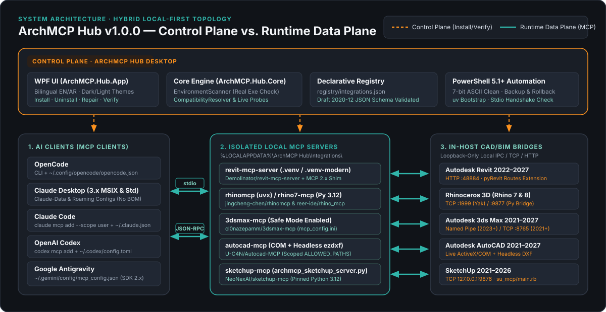
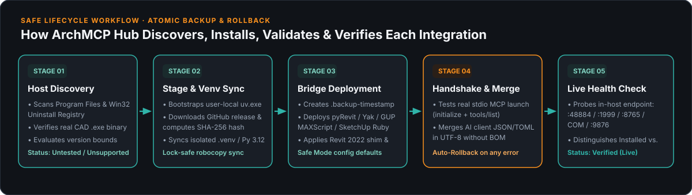

# ArchMCP Hub — Architecture (v1.0.0)

## 1. Architectural Overview

**ArchMCP Hub v1.0.0** is a local-first Windows desktop control plane for discovering, installing, configuring, disabling/uninstalling, repairing, and verifying **Model Context Protocol (MCP)** bridges across 5 engineering and 3D design applications (**Autodesk Revit 2022–2027**, **Rhinoceros 3D 7 & 8**, **Autodesk 3ds Max 2021–2027**, **Autodesk AutoCAD 2021–2027**, and **SketchUp 2021–2026**) and 5 AI clients (**OpenCode**, **Claude Desktop**, **Claude Code**, **OpenAI Codex**, and **Google Antigravity**).

### Core Architectural Principles (See [`docs/DECISIONS.md`](DECISIONS.md))
- **Control Plane vs. Runtime Data Plane Separation (`ADR-004`)**:
  ArchMCP Hub acts as the installation, configuration, and health-verification control plane. At runtime, AI clients launch and communicate directly with the isolated per-host MCP servers over `stdio` (`JSON-RPC 2.0`), and each MCP server communicates with its CAD host over a loopback-only (`127.0.0.1`) local bridge (HTTP, TCP, Named Pipe, or ActiveX/COM). ArchMCP Hub is never a mandatory runtime proxy bottleneck.
- **Hybrid Portable User-Space Layout (`ADR-003`)**:
  The Hub application can be published as a self-contained `win-x64` single-file executable (`dist\win-x64\ArchMCP.Hub.exe`). All bootstrapped tools (`uv.exe`, `uvx.exe`), upstream MCP server repositories, Python virtual environments (`.venv` and `.venv-modern`), compatibility shims, and logs reside under `%LOCALAPPDATA%\ArchMCP Hub\`, while host-specific plugins/extensions are deployed to their required per-user application directories (`%APPDATA%` / `%LOCALAPPDATA%`) without requiring administrator elevation.
- **Evidence-Based Compatibility Status (`ADR-007`)**:
  Executable discovery alone never marks an integration as `Verified`. A host reaches `Verified (Live)` only when both its local files exist on disk **and** its live in-host health check endpoint responds.

---

## 2. Logical Modules & Component Responsibilities

### A. Desktop Presentation Layer (`src/ArchMCP.Hub.App`)
- **`App.xaml` & `App.xaml.cs`**:
  - Defines the dark/light semantic color resources (`CanvasBrush`, `PanelBrush`, `PanelRaisedBrush`, `LineBrush`, `PrimaryTextBrush`, `MutedTextBrush`, `AccentBrush`).
  - Configures global exception handlers (`DispatcherUnhandledException`, `AppDomain.CurrentDomain.UnhandledException`, `TaskScheduler.UnobservedTaskException`) that log diagnostics to `%LOCALAPPDATA%\ArchMCP Hub\Logs\startup.log` without crashing silently.
- **`MainWindow.xaml` & `MainWindow.xaml.cs`**:
  - Bilingual (English / Arabic) dashboard with six workspace views (**Overview**, **Integrations**, **AI Agents**, **Compatibility**, **Activity & Logs**, **Settings**).
  - Invokes `EnvironmentScanner.Scan()` to populate the detected applications list and dispatches `Install`, `Uninstall`, `Repair`, and `Verify` actions to `scripts\Install-Integration.ps1` via `powershell.exe -NoLogo -NoProfile -ExecutionPolicy Bypass`.
  - Automatically refreshes host connection states when the spawned PowerShell process exits.

### B. Core Discovery & Compatibility Domain (`src/ArchMCP.Hub.Core`)
- **`Compatibility.cs`**:
  - Defines `CompatibilityStatus` (`Verified`, `InstalledAwaitingHost`, `ReadyToInstall`, `Untested`, `Unsupported`), `SupportedIntegrationDescriptor`, and `CompatibilityResolver`.
  - Maintains the canonical 5-host catalog (`revit-mcp-server`, `rhinomcp`, `3dsmax-mcp`, `autocad-mcp-pro`, `sketchup-mcp-hardened`) with exact version bounds, transport summaries, and bilingual activation hints.
- **`EnvironmentScanner.cs`**:
  - Scans `Program Files`, `Program Files (x86)`, and 64-bit/32-bit Windows Uninstall Registry keys (`SOFTWARE\Microsoft\Windows\CurrentVersion\Uninstall`).
  - Filters out stale registry entries and third-party add-ins by verifying that the actual host executable (`Revit.exe`, `Rhino.exe`, `3dsmax.exe`, `acad.exe`, `SketchUp.exe`) exists on disk (`IsRealHost`).
  - Implements `ProbeHostIntegrationState` to inspect both on-disk integration files and live loopback endpoints (`:48884`, `:1999`/`:9877`, `:8765`, `acad` process, `:9876`).

### C. Declarative Integration Registry (`registry/`)
- **`registry/integration-registry.schema.json`**: JSON Schema (Draft 2020-12) enforcing strict structure, allowed `hostId` values, transport types, and declarative install/uninstall actions (`ADR-006`).
- **`registry/integrations.json`**: Production registry manifest describing all 5 supported integrations.

### D. PowerShell 5.1+ Automation Engine & Python Shims (`scripts/`)

- **`scripts/ArchMCP-Common.ps1`**:
  - **`Invoke-ArchMcpNativeCommand`**: Executes native binaries (`uv`, `pyrevit`, `yak`, `python`, `opencode`, `claude`, `codex`) under `$ErrorActionPreference = 'Continue'` so `stderr` progress lines never trigger a terminating `NativeCommandError` in Windows PowerShell 5.1.
  - **`Expand-ArchMcpZipPayload`**: Extracts both nested single-root GitHub zipballs and flat release archives while verifying required payload files before staging.
  - **`Download-GitHubRepositorySource` & `Invoke-ArchMcpUvSync`**: Uses `robocopy /MIR /XD .venv .venv-modern` so running MCP server processes holding locks on `.venv\Scripts\python.exe` never block re-installation or switching AI clients.
  - **`Initialize-ArchMcpPipEnv` & `Initialize-ArchMcpModernEnv`**: Builds pinned Python 3.12 virtual environments with dependency overrides (`anyio>=4.5`, `mcp[cli]>=1.3.0,<2`) and separate `.venv-modern` (`mcp>=2,<3`) environments for Google Antigravity (`2026-07-28` `server/discover`).
  - **`Test-ArchMcpStdioHandshake`**: Spawns the exact registered MCP command over `stdio` and validates `initialize` (or `server/discover` with `-Modern`) + `tools/list` before committing client configuration changes.
  - **`Register-ArchMcpWithAgent`, `Register-ArchMcpWithClaudeDesktop`, & `Unregister-ArchMcpFromAgent`**: Non-destructively merges or removes MCP server entries across all 5 AI clients in UTF-8 without BOM, with timestamped `.backup-YYYYMMDD-HHMMSS` files and automatic byte-for-byte rollback on failure.
- **`scripts/shims/archmcp_mcp2_entry.py`**:
  - Compatibility shim that aliases `mcp.server.fastmcp` (`FastMCP`, `Image`, `Context`) to `mcp.server.mcpserver.MCPServer` in MCP Python SDK 2.x, allowing unmodified upstream FastMCP v1 servers (`revit-mcp-server`, `reer-ide/rhino_mcp`, `sketchup-mcp`) to support both Google Antigravity's `2026-07-28` `server/discover` handshake and legacy `initialize`.
